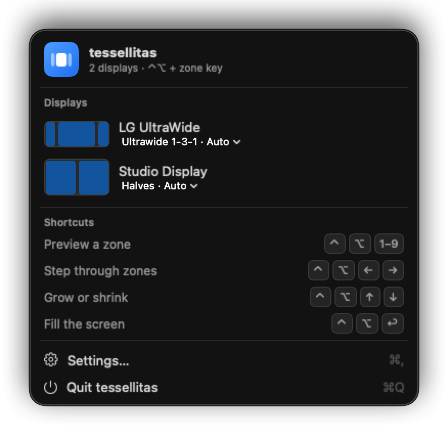
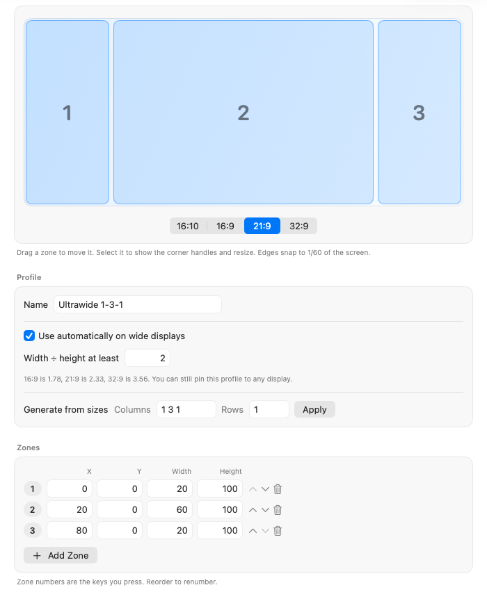

# tessellitas

Keyboard-driven window tiling for macOS, with its own layout for each display.

Split an ultrawide into ⅕ · ⅗ · ⅕ and a second monitor into halves, then snap windows into those zones with a key press. tessellitas lives in the menu bar.



## Features

- **A profile for every display.** A profile is a set of zones. Each monitor uses its own, chosen automatically by its shape or pinned by you.
- **Preview before you move.** Hold the modifiers and press a zone key to see a ghost of where the window will land. Release to apply, press Esc to cancel.
- **Fill the screen.** One key sends a window to all of the display's usable space, below the menu bar and beside the Dock. It is not macOS full screen.
- **Grow and shrink.** Make the focused window's zone bigger or smaller and its neighbours give way, so everything stays flush. The change is temporary: assigning a window to a zone again goes back to the profile.
- **Animated moves**, with a small overlay showing the new size.
- **A visual profile editor.** Drag zones around, resize them from the corners, or generate a layout from sizes such as `1 3 1`.



## Requirements

- macOS 26 or later
- Xcode to build it
- Accessibility permission, which macOS requires for moving other apps' windows

## Getting started

1. Open `tessellitas.xcodeproj` in Xcode and run the **tessellitas** scheme.
2. When macOS asks, allow tessellitas under **System Settings → Privacy & Security → Accessibility**.
3. Look for the icon in the menu bar. Focus a window and press <kbd>⌃</kbd><kbd>⌥</kbd><kbd>2</kbd>.

The app has no Dock icon and is not sandboxed, because the Accessibility API does not work inside a sandbox. Turn on **Open at login** in Settings if you want it always running.

## Shortcuts

The modifiers are <kbd>⌃</kbd><kbd>⌥</kbd> by default and can be changed in Settings.

| Keys | Action |
| --- | --- |
| <kbd>⌃</kbd><kbd>⌥</kbd> <kbd>1</kbd>–<kbd>9</kbd> | Preview the window in that zone of its display's profile (top row or keypad) |
| <kbd>⌃</kbd><kbd>⌥</kbd> <kbd>←</kbd> <kbd>→</kbd> | Step to the previous or next zone |
| <kbd>⌃</kbd><kbd>⌥</kbd> <kbd>↑</kbd> <kbd>↓</kbd> | Grow or shrink the window's zone, moving its neighbours (↑ on a loose window snaps it to the middle zone) |
| <kbd>⌃</kbd><kbd>⌥</kbd> <kbd>↩</kbd> or keypad <kbd>⌤</kbd> | Preview the window filling the display's usable area |
| Release the modifiers | Apply the previewed move |
| <kbd>Esc</kbd> | Cancel the previewed move |

Zone numbers are the order of the zones in the profile.

## Profiles

Two profiles come built in:

- **Ultrawide 1-3-1** — three full-height columns of ⅕, ⅗ and ⅕. Used automatically for displays at least twice as wide as they are tall.
- **Halves** — two columns. Used for everything else.

Open **Settings → Profiles** to edit them or add your own. Each profile has an optional aspect-ratio rule for automatic assignment. **Settings → Displays**, or the menu bar popover, lets you pin a specific profile to a specific monitor.

Grow and shrink moves the edges a zone shares with its neighbours by 5% of the display per press, and a neighbour never goes below 10%. The step size, the animation speed and the gap between windows are adjustable in **Settings → General**.

## Where settings are stored

Everything is saved automatically in the app's preferences (`~/Library/Preferences/com.sovrin.Tessellitas.plist`). To start over, use **Reset Profiles and Settings** in Settings, or run:

```sh
defaults delete com.sovrin.Tessellitas
```

## Project layout

```
tessellitas/
  TessellitasApp.swift      App entry: menu bar item and settings window
  AppModel.swift            Hotkey registration and app-wide state
  TileController.swift      Assigning, previewing, growing and shrinking windows
  ZoneResizer.swift         The edge-sliding geometry behind grow and shrink
  Zone.swift, Config.swift  Layout and settings model, with their storage
  WindowAnimator.swift      Animates window frames through per-window workers
  GhostWindow.swift         The preview overlay
  OSDWindow.swift           The size overlay
  MenuContent.swift         The menu bar popover
  Settings/                 General, Displays and Profiles screens
  Design/                   Shared views, such as key caps and the menu bar glyph
Tools/make-icon.swift       Regenerates the app icon
docs/                       README assets
```

To regenerate the app icon after editing it:

```sh
swift Tools/make-icon.swift
```

## Limitations

- Windows cannot be sent to another display yet; they are tiled on the display they are on.
- Hotkeys cover the first nine zones of a profile.
- Only windows on the current Space are resized along with a grow or shrink.
- A shortcut already claimed by another app, such as Rectangle, will not register.
